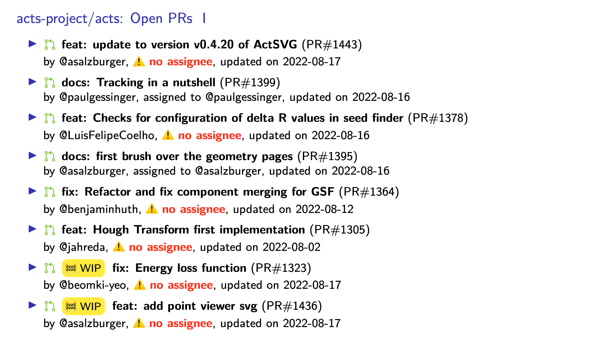

# mtng
Generate meeting notes from GitHub or GitLab + [Indico](https://getindico.io/). This tool generates
LaTeX code that can be compiled into a PDF presentation. The result looks something like this:



## Installation

```console
pip install mtng
```

## Interface

```console
$ mtng --help
Usage: mtng [OPTIONS] COMMAND [ARGS]...

  Meeting generation script, version 0.4.1

Options:
  --install-completion [bash|zsh|fish|powershell|pwsh]
                                  Install completion for the specified shell.
  --show-completion [bash|zsh|fish|powershell|pwsh]
                                  Show completion for the specified shell, to
                                  copy it or customize the installation.
  --help                          Show this message and exit.

Commands:
  auth      Authentication helpers
  generate  Generate a LaTeX fragment that includes an overview of PRs,...
  preamble  Print a preamble suitable to render fancy output
  schema    Print the configuration schema

```

```console
$ mtng generate --help
Usage: mtng generate [OPTIONS] CONFIG

  Generate a LaTeX fragment that includes an overview of PRs, Issues and
  optionally an Indico agenda

Arguments:
  CONFIG  [required]

Options:
  --token TEXT                    Github API token. Falls back to GH_TOKEN or
                                  a token stored via `mtng auth login`.
  --since TEXT                    Start window for queries. Required unless
                                  --release is used. Accepts ISO and human-
                                  readable values like "1 week ago".
  --now TEXT                      End window for queries. Accepts ISO and
                                  human-readable values like "now" or "next
                                  monday".  [default: now]
  --event TEXT                    Optionally attach an Indico based agenda
                                  overview. This only works with public
                                  events!
  --release TEXT                  Summarize merged PRs from a GitHub release
                                  tag or release URL instead of a date window.
  --preamble FILE                 Prepend this LaTeX preamble file to fragment
                                  output. Mutually exclusive with --full.
  --full                          Write a full LaTeX file that is compileable
                                  on it's own
  --pdf FILE                      Compile the report as a PDF file. This
                                  requires a LaTeX installation.
  --help                          Show this message and exit.

```

## Configuration

`mtng` consumes a configuration file to specify repositories and report sections. YAML (`.yml` / `.yaml`), TOML (`.toml`) and JSON (`.json`) are all supported.

### Ordered sections (TOML first)

TOML is the recommended format for new configurations. Define repository aliases
once, then list sections in report order. YAML and JSON accept the same schema.
See [`examples/report.toml`](examples/report.toml) for a complete example.

```toml
title = "Development update"

[repositories.acts]
name = "acts-project/acts"
display_name = "ACTS"

[[sections]]
type = "changes"
repositories = ["acts"]
state = "merged"
group_by = "category"

[sections.labels]
exclude = ["backport"]

[[sections]]
type = "changes"
repositories = ["acts"]
state = "open"
drafts = "exclude"

[[sections]]
type = "indico"
event = "https://indico.example/event/123/"
title = "Meeting agenda"
```

Run with `mtng generate report.toml --since "1 week ago" --tex report.tex`.
Replace the example event URL with a public event, or omit the Indico section.

| Section type | Content and options |
| --- | --- |
| `changes` | PRs/MRs; `state = "merged"` (default) or `"open"`. `group_by = "category"` or `"none"` (default). Merged sections include existing statistics and breaking-change slides; `summary = false` hides the statistics. |
| `statistics` | Existing statistics slide for merged PRs/MRs, without the item list. |
| `issues` | Open issues created during the reporting window. |
| `stale` | Open issues/PRs/MRs with the required `label`; existing new/all-stale slides. |
| `discussion` | Open issues with the required `label`, using existing discussion slides. |
| `indico` | Contributions from a public `event` URL, placed here in the report. |

Repository sections require `repositories = ["alias", ...]`; each repository is
rendered separately in the listed order. Optional `title` overrides their frame
titles using existing placeholders. Indico `title` is literal text. Repository
aliases refer to the existing repository settings (`name`, `forge`, `host`,
`display_name`, category styling, assignee/review display, etc.). Only referenced
repositories require credentials.

Section-local `[sections.labels]` supports `include` (all labels must match) and
`exclude` (any matching label excludes the item). These replace repository-level
label filters for that section. Section types control which data is collected;
legacy `do_*` content switches and stale/discussion labels on a repository do not
create additional sections. `group_by` controls category grouping locally.

For open changes, `drafts = "include"`, `"exclude"` (effective default), or `"only"`
uses both native draft state and the repository's optional `wip_label`. Legacy
`show_wip` does not override this explicit selection.

Merged changes and statistics can set `release = "v1.2.3"` locally. CLI `--release`
is their fallback; it does not suppress other explicit sections. `--since` is
required for period-based merged/statistics sections and for issues/stale sections.
It is optional for open-only, discussion-only, Indico-only, and release-only reports.
Use explicit Indico sections instead of `--event` in this configuration format.

Section ordering changes composition, not slide styling. Statistics, grouping,
breaking-change treatment, item layout, and LaTeX/PDF output otherwise retain
existing behavior. Contributors, changed-path filters, and revised review reporting
are not introduced by this configuration refactor.

`--save-data` and `render --config` support explicit sections, including saved
Indico events. Sections can be reordered, restyled, or omitted offline. A new query
or event missing from the snapshot fails rather than accessing the network.

### Shared configs and overlays

Pass `--config` (or `-c`) multiple times to share repository definitions between
meetings:

```toml
# repositories.toml
[repositories.acts]
name = "acts-project/acts"
display_name = "ACTS"
```

```toml
# meeting.toml
title = "Weekly development update"

[[sections]]
type = "changes"
state = "open"
repositories = ["acts"]
```

```bash
mtng generate --config repositories.toml --config meeting.toml --full --tex report.tex
# The existing positional config is also supported and is applied first:
mtng generate repositories.toml -c meeting.toml --full --tex report.tex
mtng render report-data.json -c repositories.toml -c meeting.toml --tex report.tex
```

Files may mix TOML, YAML, and JSON. Mappings merge recursively; later values
win. Lists (including `sections`, legacy `repos`, and label filters) are replaced,
not concatenated. An empty list clears an inherited list; an explicit YAML/JSON
`null` replaces the earlier value where the schema permits it. For example,
`[repositories.acts]` in a later TOML file can override only `display_name`, keeping
the shared `name` and other settings. Omitted values remain inherited.

Validation runs after all files have been merged, so a shared repository file
needs no sections of its own. Only repositories referenced by the final sections
are collected. Saved report data contains the merged configuration. On `render`,
the merged config files replace the saved config, just as a single `--config` did;
the existing restrictions against requesting uncollected data still apply.

### Existing configurations

Existing `repos` configurations remain supported without migration, in TOML,
YAML, and JSON. They retain their default sections, ordering, CLI `--release` /
`--event` behavior, and output. Do not mix `repos` with explicit `sections`.
To migrate, move repository entries to `[repositories.<alias>]`, add the desired
`[[sections]]`, and move selection filters into those sections. Presentation
settings can stay on the repository. The GitHub Action accepts section configs via
its `config` input; its existing inline inputs continue to produce legacy configs.

An example YAML configuration could look like this:

```yml
title: Weekly PR and issue update
footline_left: Core team
repos:
  - name: acts-project/acts
    stale_label: Stale
    wip_label: ":construction: WIP"
    show_wip: true
    group_prs_by_category: true
    pr_category_labels:
      feat: New features
      fix: Bug fixes
    pr_category_colors:
      feat: LimeGreen
      fix: Purple
      breaking: alertred
    pr_category_order: [fix, feat]
    do_recent_issues: true
    no_assignee_attention: true
    filter_labels:
      - backport
```

### GitLab and mixed-host reports

The CLI supports GitLab.com and self-hosted GitLab, including CERN. Existing
configurations default to GitHub. Keep `name` as the project path; select GitLab
with `forge` and optionally `host` (an HTTPS hostname, without an API path).
Nested GitLab groups are supported:

```toml
[[repos]]
name = "acts-project/acts"
display_name = "ACTS on GitHub"

[[repos]]
name = "group/subgroup/project"
forge = "gitlab"
host = "gitlab.cern.ch"
display_name = "CERN project"
do_recent_issues = true
do_reviewers = true
```

Use unique `display_name` values if project paths repeat across hosts. GitHub
Enterprise and GitLab installations under URL subpaths are not supported.
The bundled GitHub Action remains GitHub-only; use the CLI for GitLab reports.

Store a GitLab personal access token with `read_api` access:

```console
mtng auth login --host gitlab.cern.ch
mtng auth check --host gitlab.cern.ch
mtng auth status --host gitlab.cern.ch
mtng generate report.toml --since "1 week ago" --full --tex report.tex
```

`auth` defaults to github.com; any other host selects GitLab. Tokens resolve from
`--token`, then `GH_TOKEN` (GitHub) or `GITLAB_TOKEN` (GitLab), then the system
keychain. `--token` requires exactly one backend/host in the configuration.
`GITLAB_TOKEN` is accepted only when there is one GitLab host. For several GitLab
hosts, unset that variable and run `auth login --host ...` for each host. Existing
GitHub keychain entries continue to work. Cached API results are separated by
host and credentials.

GitLab reports use MR terminology and `!123` references. Existing `do_*_prs`
and `pr_category_*` settings apply to MRs as well; explicit frame-title overrides
are preserved. GitLab date windows include MRs whose `merged_at` lies within the
specified bounds, even if they were edited later. GitHub retains its existing
calendar-date search behavior.

For a GitLab release, use `--release v1.0` or a matching project release URL.
The release description must reference its merged MRs using `!123` or full
project MR URLs. References to other projects are ignored. A tag applies to
every configured repository; a full URL must match the repository and host.

GitLab review summaries include approvals and assigned reviewers. Comment and
change-request histories are not inferred from account state. If an instance
lacks the approvals endpoint, the report marks review data unavailable;
authentication and server failures remain errors. Line/commit counts are left
unknown rather than reported as zero. Detailed diff statistics and report-mode
redesign are follow-up work.

### Schema
- **`Repository`** *(object)*: Cannot contain additional properties.
  - **`forge`** *(string)*: `github` (default) or `gitlab`.
  - **`host`** *(string or null)*: HTTPS host; defaults to github.com or gitlab.com.
  - **`name`** *(string)*: Name of the repository, e.g. 'acts-project/acts'.
  - **`display_name`** *(string)*: Alternative repository name. Useful when fetching one repository multiple times.
  - **`wip_label`** *(string)*: Label to identify WIP PRs.
  - **`show_wip`** *(boolean)*: If true, WIP PRs will be included in the output, else they are ignored. Default: `False`.
  - **`filter_labels`** *(array)*: If any PR or issue has any label that matches any of these labels, they are excluded. Mutually exclusive with `include_labels` and `exclude_labels`.
    - **Items** *(string)*
  - **`include_labels`** *(array)*: If set, only PRs or issues that have all of these labels are included. Mutually exclusive with `filter_labels`.
    - **Items** *(string)*
  - **`exclude_labels`** *(array)*: If any PR or issue has any label that matches any of these labels, they are excluded. Mutually exclusive with `filter_labels`.
    - **Items** *(string)*
  - **`stale_label`** *(string)*: A label to identify stale PRs/issues. If set, stale PRs and issues will be listed separately and split into newly and other stale items.
  - **`do_open_prs`** *(boolean)*: Show a list of open PRs. Default: `True`.
  - **`do_merged_prs`** *(boolean)*: Show a list of merged PRs. Default: `True`.
  - **`do_recent_issues`** *(boolean)*: Show a list of issues opened in the time interval. Default: `False`.
  - **`no_assignee_attention`** *(boolean)*: Draw attention to items without an assignee. Default: `True`.
  - **`do_reviewers`** *(boolean)*: Show reviewer information for PRs. Default: `False`.
  - **`show_review_summary`** *(boolean)*: Show review outcome text (for example, `reviewed by`). Default: `True`.
  - **`truncate_pr_titles`** *(boolean)*: Fit PR titles on one line by replacing the middle with an ellipsis at word boundaries (character fallback for one- or two-word titles), reserving space for status/category badges and the linked PR number. Short titles remain unchanged. Default: `False`.
  - **`show_pr_categories`** *(boolean)*: Parse conventional-commit style prefixes from PR titles and render category pills. Default: `True`.
  - **`group_prs_by_category`** *(boolean)*: Group open and merged PR slides into one section per category. Default: `False`. Section pages are titled with the category alone (`Feature`, `Bugfix`, ...); the `fix` category also carries a 🐛.
  - **`pr_category_labels`** *(object)*: Override display names for category keys used in pills and grouped sections (for example, `feat: Feature`).
  - **`pr_category_colors`** *(object)*: Override LaTeX color names for category pills. Supports keys like `feat`, `fix`, `docs`, `other`, and `breaking`.
  - **`show_breaking_changes`** *(boolean)*: Give merged breaking PRs their own leading section. Default: `True`. See [breaking changes](#breaking-changes).
  - **`repeat_breaking_changes`** *(boolean)*: Keep breaking PRs in the regular merged/category slides as well. Default: `True`.
  - **`pr_category_order`** *(array)*: Order of the grouped category sections. Categories that are not listed follow in the default order.
    - **Items** *(string)*
  - **`frame_titles`** *(string or object)*: Override the title of a kind of frame, either as one string used for every frame or as a map. See [frame titles](#frame-titles).
  - **`Spec`** *(object)*: Cannot contain additional properties.
    - **`title`** *(string)*: Deck title shown on the title slide. Supports the [placeholders](#placeholders) `{release}`, `{repos}`, `{since}` and `{date}`. If omitted, mtng uses the default repository-based title.
    - **`footline_left`** *(string)*: Left-side text shown in the footline. Supports the [placeholders](#placeholders) `{release}`, `{repos}`, `{since}` and `{date}`. If omitted, `mtng` is used.
    - **`accent_color`** *(string)*: Accent for titles, footline, bullets, and standard blocks in full presentations (`--full` or PDF output). Use six hexadecimal digits with an optional `#`, for example `accent_color = "#7C3AED"`. Defaults to `22529E` (the existing blue). Fragment output inherits the containing document's theme.
    - **`repos`** *(array)*
      - **Items**: Refer to *#/definitions/Repository*.
  The equivalent TOML configuration is:

```toml
title = "Weekly PR and issue update"
footline_left = "Core team"
[[repos]]
name = "acts-project/acts"
stale_label = "Stale"
wip_label = ":construction: WIP"
show_wip = true
group_prs_by_category = true
pr_category_labels = { feat = "New features", fix = "Bug fixes" }
pr_category_colors = { feat = "LimeGreen", fix = "Purple", breaking = "alertred" }
pr_category_order = ["fix", "feat"]
do_recent_issues = true
no_assignee_attention = true
filter_labels = ["backport"]
```

This configuration will look up the `acts-project/acts` repository. The output will contain sections on

1. Stale PRs and issues. If this is turned on, the `stale_label` key must be given as well
2. A list of open PRs, optionally filtered to not include the label given by `wip_label`
3. Merged PRs since the date given by the `--since` option
4. Issues opened since the date given by the `--since` option


### PR categories

Conventional-commit prefixes on PR titles (`feat:`, `fix(core)!:`, ...) drive the pill next
to each PR and, with `group_prs_by_category`, the section a PR lands in. The defaults are:

| Key | Label | Section page | Pill color |
| --- | --- | --- | --- |
| `feat` | Feature | 🚀 | LimeGreen |
| `fix` | Bugfix | 🐛 | Purple |
| `refactor` | Refactor | ♻️ | CadetBlue |
| `perf` | Performance | ⚡ | TealBlue |
| `docs` | Docs | 📚 | CornflowerBlue |
| `test` | Tests | 🧪 | RoyalBlue |
| `build` | Build | 🔨 | Goldenrod |
| `ci` | CI | 🤖 | Orange |
| `chore` | Chore | ⚙️ | Gray |
| `revert` | Revert | 🔄 | Mahogany |
| `other` | Other | 📦 | beige |

Titles that do not parse land in `other`; a `!` marks the PR as breaking with a separate 🚨 marker beside 🆕 (when present).
The category retains its normal color; `breaking` controls the marker’s text fallback color when emoji fonts are unavailable. The table order is also the order of the grouped sections, and
`pr_category_order` overrides it — listed categories come first, the rest follow in the
default order:

```yml
pr_category_order: [fix, feat]
```

### Breaking changes

A `!` in the prefix (`feat!:`, `fix(core)!:`) marks a PR as breaking. Merged breaking PRs are
pulled out of the categories into a ⚠️ section of their own, ahead of the category sections,
so they lead the deck. The section is skipped when nothing broke, and only covers merged
(or, with `--release`, released) PRs — open breaking work keeps its red pill where it is.

Two switches control it, per repository:

```yml
show_breaking_changes: true      # the section itself; default true
repeat_breaking_changes: false   # list them ONLY there, not under their category
```

With `repeat_breaking_changes` left at its default, a breaking PR appears twice: once in the
breaking section and once under its own category. Set it to `false` to move them out of the
category slides entirely. Its frame title is the `breaking_changes` key in
[`frame_titles`](#frame-titles).

### Placeholders

`title` and `footline_left` are expanded before rendering, so the release the deck was
generated for can be pulled into the title slide or the footline:

```yml
title: ACTS {release}
footline_left: Core team -- {release}
```

| Placeholder | Expands to |
| --- | --- |
| `{release}` | The release tag(s) resolved from `--release`. Empty when not in release mode. |
| `{repos}` | The repositories in the spec, by `display_name` where set. |
| `{since}` | The start of the reporting window (`--since`), as `YYYY-MM-DD`. |
| `{date}` | The generation date, as `YYYY-MM-DD`. |
| `{range}` | The reporting window, as `between <since> and <now>`. |

Unknown keywords are left untouched, so `{}`-heavy LaTeX in these strings still works. A
placeholder that expands to nothing takes a dangling separator, or an empty pair of
brackets, with it: `Core team -- {release}` is just `Core team` outside of release mode.

### Frame titles

`frame_titles` overrides the title of a kind of frame, per repository, using the same
placeholders plus `{repo}` (the repository's `display_name`, or its name) and `{category}`
(the PR category, when `group_prs_by_category` is on).

A single string is shorthand for "this title, on every frame" — with the placeholders
carrying the per-frame detail, that is often all you need:

```yml
repos:
  - name: acts-project/acts
    frame_titles: "{repo} {category}"
```

A map overrides individual frames instead:

```yml
repos:
  - name: acts-project/acts
    frame_titles:
      merged_prs: "What landed {range} -- {category}"
      open_prs: "{repo}: in flight ({category})"
```

| Key | Default |
| --- | --- |
| `breaking_changes` | `{repo}: Breaking changes` |
| `merged_prs` | `{repo}: PRs merged {range} ({category})` |
| `release_prs` | `{repo}: PRs in release {release} ({category})` |
| `open_prs` | `{repo}: Open PRs ({category})` |
| `recent_issues` | `{repo}: Issues opened since {since}` |
| `new_stale` | `{repo}: New stale Issues / PRs since {since}` |
| `all_stale` | `{repo}: All stale Issues / PRs` |
| `needs_discussion` | `Needs discussion` |
| `stats` | `{repo}: period at a glance` |
| `release_stats` | `{repo}: release {release} at a glance` |

Keys are validated, so a typo is a configuration error rather than a silently ignored
setting. Only the keys you list are overridden; the rest keep their defaults. Because
`{category}` is empty unless PRs are grouped, the default `({category})` suffix disappears
by itself in ungrouped decks.

In addition and independent of this config, a meeting agenda can be attached at the end if the `--event` option is provided and contains a valid Indico URL.

If `--release` is provided, merged PRs are parsed from the release description (for links like `https://github.com/<owner>/<repo>/pull/<number>`) instead of the `--since`/`--now` range, and `--since` is optional.

## Authentication

You can provide a token explicitly with `--token`, via `GH_TOKEN`, or store one in your OS keychain:

```console
$ mtng auth login
GitHub API token: ********
Stored GitHub token for @your-user in your system keychain.
```

`mtng auth login` validates the token by default. You can also check your current token with:

```console
$ mtng auth check
GitHub token is valid for @your-user.
```

To see where the current token is loaded from:

```console
$ mtng auth status
GitHub token is configured (source: system keychain).
```

## Making a presentation

By default, the output of `mtng generate` is a LaTeX fragment. It has to be incorporated into a set of Beamer/LaTeX slides, for example like

```console
$ mtng generate spec.yml > gen.tex
$ mtng generate spec.toml > gen.tex
```

with a LaTeX file like

```latex
% Preamble and beginnig of slides
\input{gen.tex}
% Rest of slides
```

Both `generate` and `render` write plain LaTeX to stdout, without panels, markup
interpretation, or line wrapping, whether stdout is a terminal or redirected.
Progress, compiler logs, and file confirmations go to stderr.
Use `--tex report.tex` to write the source to a file instead of stdout, or
`--pdf report.pdf` to compile a PDF without dumping the source. Combine `--tex`
and `--pdf` to save both files.

`--full` controls only the document structure: it produces a standalone LaTeX
document instead of a fragment. PDF compilation automatically selects a complete
document when no custom preamble is supplied.

```console
$ mtng generate spec.yml --full > gen.tex
$ latexmk gen.tex
```

If you have your own deck preamble and still want direct PDF output, pass it with `--preamble` together with `--pdf`:

```console
$ mtng generate spec.yml --since 2024-01-01 --preamble mypreamble.tex --pdf notes.pdf
```

If `--preamble` points to a full `.tex` deck file (contains `\documentclass` or `\begin{document}`), `mtng` fails with an explicit error; pass a preamble-only file instead.

## GitHub Action

This repository is also a reusable action that generates the PDF summary for the project it
runs in, either for a release or for a time period. It installs a LaTeX toolchain, installs
`mtng`, and runs `mtng generate --pdf`.

Summarize every release, as it is published:

```yml
name: Release summary
on:
  release:
    types: [published]

jobs:
  summary:
    runs-on: ubuntu-latest
    steps:
      - uses: paulgessinger/mtng@v0.8.3
        with:
          title: "{repos} {release}"
          group_prs_by_category: "true"
          upload-artifact: "true"
```

The `release` input defaults to the tag of the release that triggered the workflow, and
`repository` defaults to the repository the action runs in, so the above needs no further
configuration. Merged PRs are then read from the release description.

Summarize a period instead, for example as a weekly report:

```yml
on:
  schedule:
    - cron: "0 7 * * MON"

jobs:
  summary:
    runs-on: ubuntu-latest
    steps:
      - uses: paulgessinger/mtng@v0.8.3
        with:
          since: 1 week ago
          stale_label: Stale
          do_recent_issues: "true"
          output: reports/weekly.pdf
          upload-artifact: "true"
```

Either `release` or `since` must be set. `since` and `now` accept the same ISO and
human-readable values as the CLI.

### Configuration

The action takes its configuration in one of two ways, and refuses to mix them:

- **Inline**, through the inputs named after the [config schema](#schema) fields
  (`stale_label`, `wip_label`, `group_prs_by_category`, ...), which describe a single
  repository. This is what the examples above use.
- **From a file**, through the `config` input, which points at a checked-in TOML, YAML or
  JSON config. Use this to report on several repositories, or to share the config with local
  `mtng` runs:

  ```yml
  - uses: actions/checkout@v4
  - uses: paulgessinger/mtng@v0.8.3
    with:
      config: .github/mtng.toml
      since: 1 week ago
  ```

  The config file is read from the workspace, so the workflow has to check the repository out
  first.

  Combining `config` with any of the inline spec inputs is an error, so a config file is never
  silently half-overridden.

List-valued inputs (`filter_labels`, `pr_category_order`, ...) take one entry per line or a
comma-separated list; map-valued inputs (`pr_category_labels`, `pr_category_colors`,
`frame_titles`) take `key=value` entries in the same shape:

```yml
with:
  filter_labels: |
    backport
    Stale
  pr_category_labels: feat=Feature, fix=Bugfix
```

### Action inputs

Besides the spec fields, the action accepts:

| Input | Default | Description |
| --- | --- | --- |
| `config` | | Path to a config file. Mutually exclusive with the spec inputs. |
| `repository` | current repository | Repository to summarize, as `owner/name`. |
| `release` | tag of the triggering release | Release tag or URL to summarize. |
| `since` / `now` | / `now` | Reporting window. `since` is required unless `release` is set. |
| `event` | | Indico event URL to attach as an agenda. |
| `output` | `mtng-summary.pdf` | Path of the PDF to write. |
| `tex` | | Optional path to also write the LaTeX source to. |
| `preamble` | | LaTeX preamble file to use instead of the built-in one. |
| `upload-artifact` | `false` | Upload the PDF as a workflow artifact. |
| `artifact-name` | `mtng-summary` | Name of that artifact. |
| `artifact-retention-days` | | Retention period of that artifact. |
| `token` | `github.token` | Token used for the GitHub API queries. |
| `mtng-version` | | Version to install from PyPI. Defaults to the source of the action ref itself. |
| `install-latex` | `true` | Install a LaTeX toolchain with apt. Set to `false` if the runner or container already has `latexmk`. |
| `emoji` | `true` | Also install the LuaTeX toolchain and a color emoji font, so emoji render. |
| `latex-packages` | base toolchain | apt packages to install for LaTeX. |
| `emoji-packages` | `texlive-luatex fonts-noto-color-emoji` | apt packages added when `emoji` is true. |

Outputs are `pdf` (the path of the generated PDF) and `config` (the path of the spec that was
used, generated or given).

Emoji only render under `lualatex`, which is why `emoji` pulls in an extra toolchain. Turning it
off gives a smaller, faster pdflatex-only install; the deck then compiles with the emoji left
out, which is also what happens on any TeX installation without an emoji font:

```yml
with:
  emoji: "false"
```

## GitLab development tests

Run adapter and authentication tests without network access:

```console
uv run --group dev pytest tests/test_forge_gitlab.py tests/test_gitlab_config_auth.py -m "not integration"
```

The fixtures are synthetic examples of documented GitLab REST payloads. For the
optional live smoke test, set `GITLAB_TOKEN`, `MTNG_GITLAB_TEST_PROJECT` (a project
path you can read), and optionally `MTNG_GITLAB_TEST_HOST` (default gitlab.com),
then run `uv run --group dev pytest tests/test_forge_gitlab.py -m integration`.

### Offline tests and live smoke checks

`uv run --group dev pytest` excludes `integration` by default. Ordinary tests
reject live aiohttp/requests calls and use checked-in payloads; the CI PDF job
renders those fixtures with `python tests/render_fixtures.py`. Action input
handling is covered by `tests/test_action.py` without live report collection.

The **Live API smoke test** workflow is manually dispatched and makes at most
three GitHub requests against this repository. To run it locally, set `GH_TOKEN`
and `MTNG_GITHUB_TEST_PROJECT=owner/repo`, then run
`uv run --group dev pytest tests/test_live_github.py -m integration -n 1`.
Live checks bypass the application cache; cached success is not API validation.

### API response cache

GitHub and GitLab use a persistent JSON HTTP cache under the platform's mtng
cache directory (`http-v1/`). Keys isolate origins, query parameters, credentials
and representation headers. Responses are reused locally for five minutes by
default, even when the server specifies a shorter lifetime or `no-cache`.
This deliberate local snapshot can be stale for that window; `no-store` responses
are never persisted. Set top-level `cache_max_age = 300` in TOML (or
`cache_max_age: 300` in YAML) to configure the window in seconds. Values must be
non-negative; zero revalidates every time. An explicit `--cache-max-age SECONDS`
overrides the config, and `--refresh` forces revalidation regardless of either setting. Expired responses are revalidated using
ETag or Last-Modified when available; validators and bodies are retained for up
to 30 days. Errors never substitute stale successful data. Old model caches are
no longer read.

Use `generate --refresh` to revalidate immediately, `--no-cache` to bypass disk
reads/writes, and `--cache-stats` to print hit, request, revalidation, retry and
shared-request counts. Authentication checks bypass the cache. Cached data may
include private repository content; it stays scoped to the requesting credentials.

Within one process, identical simultaneous requests share a response and requests
to GitHub overlap with at most four in flight per origin. Starts are spaced at
least 0.2 seconds apart, with search requests spaced at least 2.1 seconds apart.
Credential-scoped search/core budgets reserve quota before dispatch, leaving a
small safety margin. Throttling pauses the origin and reduces its request rate;
GitLab requests remain serialized. Coordination is local to one process, so other
clients sharing a token and undisclosed secondary limits can still cause throttling.
Rate-limit headers control retry timing, with at
most three attempts and a 60-second total wait budget. Longer limits produce an
error with retry timing instead of retrying early. CI jobs are independent, so
normal CI uses offline fixtures rather than relying on shared private caches.

### Save once, render offline

Save normalized collection results alongside the first rendered report:

```console
mtng generate report.toml --since "1 week ago" --save-data report-data.json --tex report.tex
mtng render report-data.json --full --pdf report.pdf
mtng render report-data.json --config presentation.toml --tex revised.tex
```

`render` uses no credentials, keychain or HTTP session. Snapshots contain a
versioned JSON schema, the original configuration/time window, normalized query
results and optional Indico contributions. They contain no API credentials or
HTTP headers, but can contain private report content; share them accordingly.
Unknown schema versions are rejected.

The optional configuration override can change titles, grouping, display names
and presentation flags or omit sections. Requesting new repositories, filters,
sections or enrichment that were not collected fails with instructions to collect
a new snapshot. Rendering cannot silently fetch missing data or invent it.

Open PRs/MRs fetch reviews only when their review summary is displayed. GitHub
also skips per-PR detail requests when neither reviews nor details are needed.
Merged/release data still fetches the information needed for the statistics tiles.
This separates collection requirements from presentation without changing report
modes or adding more mode flags.

### Collection progress

Interactive terminals show section/repository progress and completed/total counts
for PR/MR details and reviews. Searches count discovered items as pages arrive,
without guessing the final total. API retry waits identify the host and wait time.
LaTeX rendering and compilation retain a status indicator because their total work
is not known. Progress goes to stderr; redirected and CI runs receive plain stage
and completion messages instead of animated bars. Failed work is marked stopped,
not complete.

PR bullets show additions/deletions and files changed when the backend supplies
those counts. Open PRs show human-readable ages (for example, `open for 18 days` or
`opened today`), measured at the report date. Inactivity is shown only after at
least one calendar day. Drafts use a muted icon and a Draft badge. With `do_reviewers =
true` and `show_review_summary = true`, PRs show a compact, consistently sized review status without reviewer usernames;
changes requested takes precedence over approval, using each reviewer's latest
decisive review. These are review summaries, not mergeability checks. Include
drafts with `drafts = "include"` on a changes section. Older saved reports may
need recollecting to supply review and diff details.

Open PRs created within the inclusive since–now reporting window carry a `NEW`
badge. Metadata wraps within the list width, and PR bullets stay together when
continued onto the next slide.
